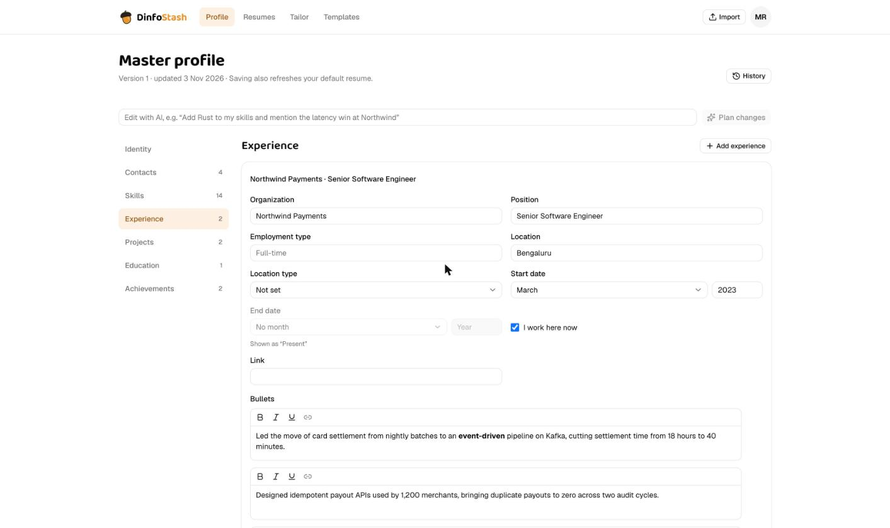
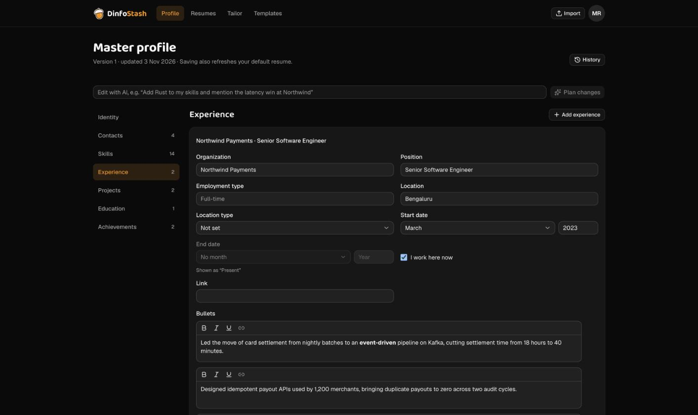
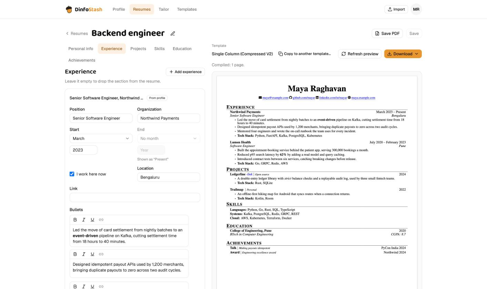
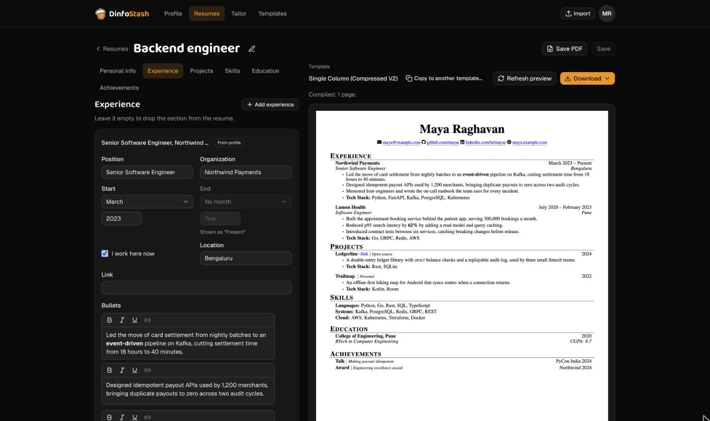
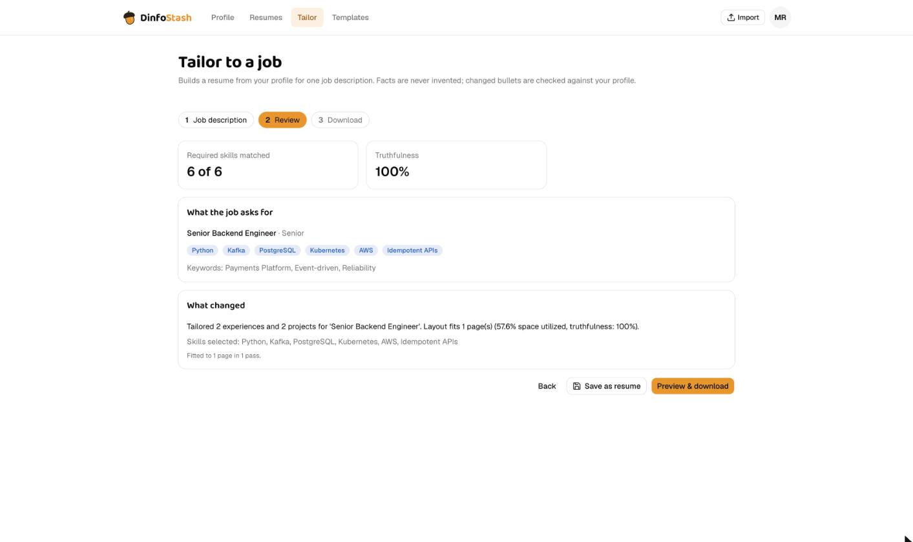
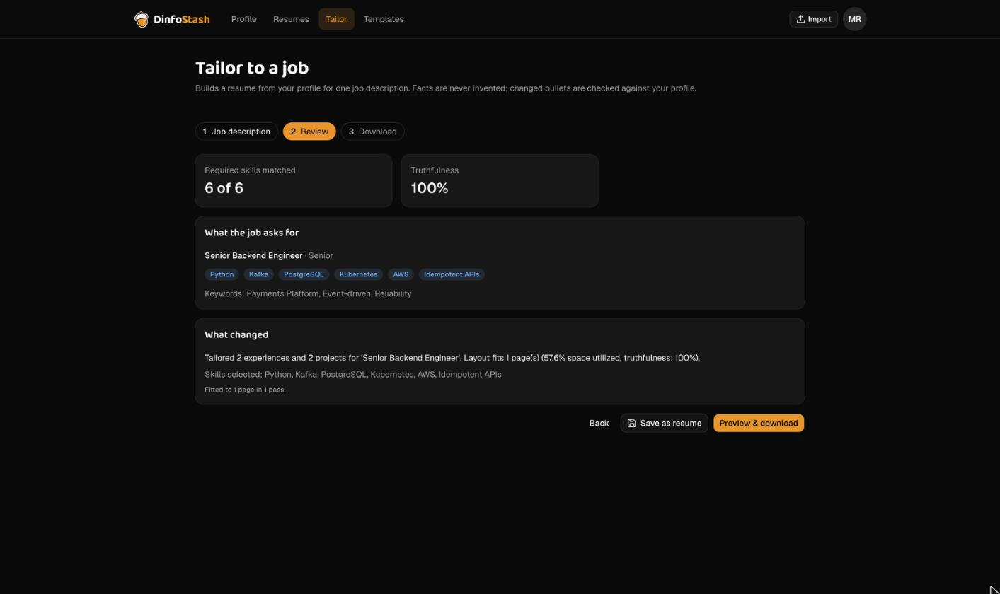
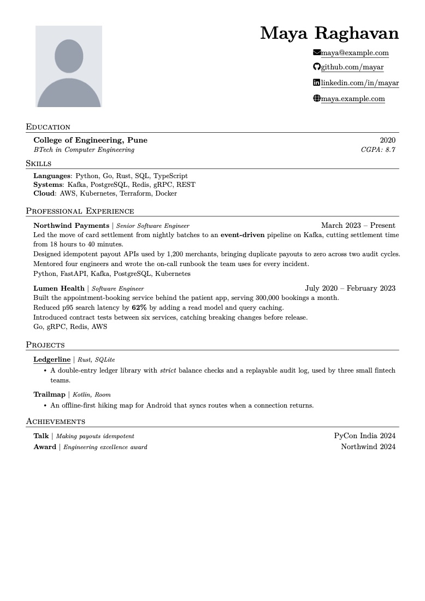
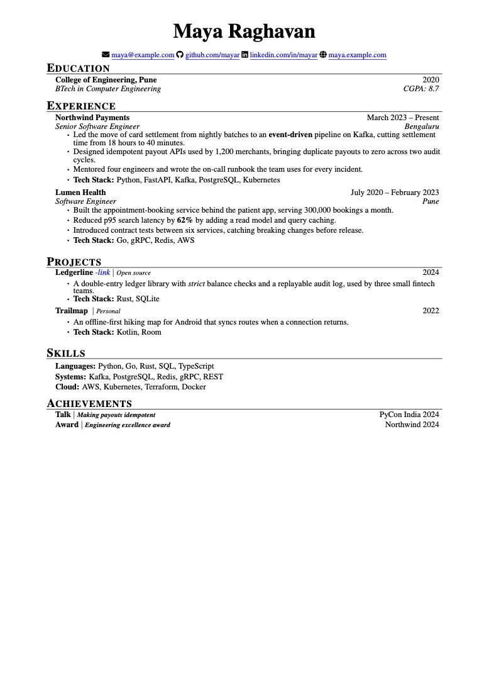

<p align="center">
  <picture>
    <source media="(prefers-color-scheme: dark)" srcset="brand/logo-lockup-dark-h256.png">
    
  </picture>
</p>

<p align="center">
  Keep your whole career in one profile, and turn it into print-ready PDF resumes.
</p>

<p align="center">
  <a href="https://dinfostash-prod.web.app"><b>Open DinfoStash</b></a>
</p>

---

DinfoStash is a web app for keeping one complete record of your work, and building as many
resumes from it as you need. Each resume has its own selection of content and its own
template; none of them ever changes the profile.

This repository is a showcase: it holds screenshots, example output and instructions. The
application's source code is private.

## What you can do

- **Keep one profile** of your jobs, projects, skills, education, achievements and contact
  details.
- **Import an existing resume** (PDF, LaTeX, plain text or JSON) instead of typing it all
  again. You review what was read, with a quality score for the result, before anything is
  saved.
- **Import projects from GitHub**: every public repository of a GitHub profile, or just one,
  as projects you review before they are saved. With AI, each project's summary, points and
  skills are written from its README and checked against it.
- **Build several resumes** from the profile and keep them side by side, for example a
  backend version and a DevOps version.
- **Format text** with bold, italic, underline and links. No LaTeX knowledge needed.
- **Pick a template** and download a typeset PDF. The studio shows the real page count as
  you edit.
- **Tailor a resume to a job description** with AI. The rewrite fits what the chosen
  template prints, and points that add numbers your profile does not have are put back.
- **Edit your profile in plain language** with AI ("add my new job at…"). Changes are shown
  for review before they are saved, and earlier versions can be restored. Paste a link to
  a public page, such as an article about your work, and the AI reads it too.
- **Save PDFs** to your account and share one by link.
- **Export or delete your account** yourself, from the Account page.
- **Use your profile elsewhere** through a read-only API: keep a portfolio site in sync,
  build your PDF in CI, or give a tool your career history. Your profile is also available
  as [JSON Resume](https://jsonresume.org/schema).

## Screenshots

Taken with a fictional profile.

| | Light | Dark |
| --- | --- | --- |
| Profile |  |  |
| Resume studio |  |  |
| Tailoring |  |  |

## Templates

Every template prints on A4. These examples are made from fictional profiles; the PDFs are
in [`examples/pdf`](examples/pdf).

| Classic single column | With a photo | Compact |
| --- | --- | --- |
| [](examples/pdf/SingleColumnNoPhoto.pdf) | [](examples/pdf/SingleColumnPhoto.pdf) | [](examples/pdf/SingleColumnCompressed.pdf) |

| Compact with a photo | Compact, refreshed layout | Bio-data (every profile field) |
| --- | --- | --- |
| [](examples/pdf/SingleColumnPhotoCompressed.pdf) | [](examples/pdf/SingleColumnCompressedV2.pdf) | [](examples/pdf/Biodata.pdf) |

## Tailoring example

The fictional profile above, tailored to this job description:

> Senior Backend Engineer, Payments Platform. Build event-driven payment services in
> Python and Kafka, own PostgreSQL data models, and run services on Kubernetes in AWS.
> You care about idempotent APIs, reliability and mentoring engineers.

DinfoStash found the six skills the job asks for, chose and rewrote the matching
experience and project points, and fitted the result to one page. Every changed point is
checked against the profile, so nothing is invented (truthfulness 100%); see the
Tailoring screenshots above.

## Getting started

1. Open [DinfoStash](https://dinfostash-prod.web.app) and sign up with your email or with Google.
2. Import an existing resume, or fill in your profile by hand.
3. Open **Resumes**, create a resume, pick a template and choose what to include.
4. Download the PDF, or save it to your account to share later.

AI features (import reading, tailoring, plain-language edits) are turned on per account.

## For developers

Create a personal access token on your Account page, choosing what it may read, and call
the API with it:

```sh
curl https://dinfostash-prod.web.app/api/public/v1/profile/json-resume \
  -H "Authorization: Bearer $DINFOSTASH_TOKEN"
```

Tokens are read-only and can be revoked at any time. The
[developer guide](https://dinfostash-prod.web.app/developers) has the quickstart, scopes,
recipes and rate limits, and the
[API reference](https://dinfostash-prod.web.app/developers/reference) lists every
operation.

## Privacy and terms

- [Privacy policy](https://dinfostash-prod.web.app/privacy)
- [Terms of use](https://dinfostash-prod.web.app/terms), including the
  [API terms](https://dinfostash-prod.web.app/terms#api)

## Contact

Questions and feedback: [amulya1171@gmail.com](mailto:amulya1171@gmail.com)

## License

Copyright © 2024–2026 Amulya Paritosh. All rights reserved. See [LICENSE](LICENSE).
